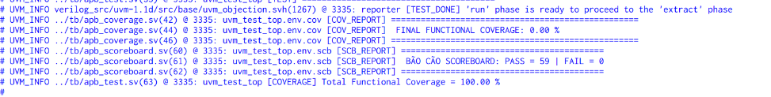
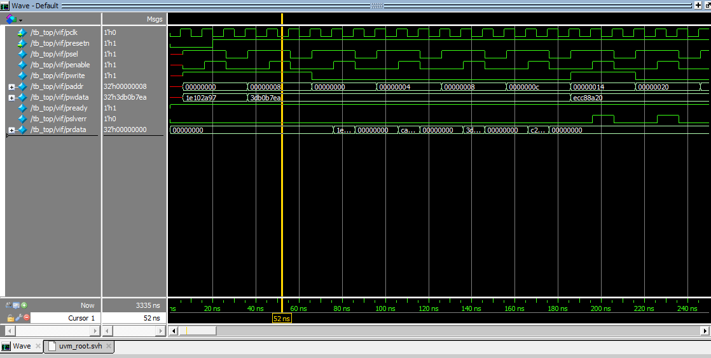

# APB Slave: RTL và UVM Testbench

Thiết kế một APB3 slave 32-bit có 4 thanh ghi và môi trường kiểm chứng UVM 1.1d chạy trên QuestaSim.
Project gồm RTL tự thiết kế, testbench UVM đầy đủ các thành phần (agent, scoreboard với reference model, functional coverage), sequence constrained-random, và tài liệu verification.

## DUT

`rtl/async_apb_slave.sv`: APB3 slave, reset bất đồng bộ tích cực mức thấp (`presetn`), `pready` luôn bằng 1.

| Địa chỉ | Thanh ghi | Truy cập | Mô tả |
|---|---|---|---|
| 0x00 | `sys_ctrl` | RW | Bit 0 điều khiển chế độ đảo của `data_out` |
| 0x04 | `sys_status` | RO | Hằng số `0xCAFE_BABE` |
| 0x08 | `data_in` | RW | Dữ liệu 32 bit |
| 0x0C | `data_out` | RO | `sys_ctrl[0] ? ~data_in : data_in` |

Quy tắc lỗi: ghi vào thanh ghi RO hoặc truy cập địa chỉ ngoài vùng thì `pslverr = 1` (đọc ngoài vùng trả `prdata = 0`). Địa chỉ chỉ được decode bằng `paddr[7:0]`.

## Kiến trúc testbench

```
apb_test
 ├── apb_sequence ── (start trên sequencer)
 └── apb_env
      ├── apb_agent
      │    ├── uvm_sequencer
      │    ├── apb_driver  ──▶ apb_if ◀──▶ DUT
      │    └── apb_monitor ──┐
      ├── apb_scoreboard ◀───┤   (reference model)
      └── apb_coverage   ◀───┘   (functional coverage)
```

| Thành phần | File | Vai trò |
|---|---|---|
| Interface | `tb/apb_if.sv` | Tín hiệu APB, clocking block, modport |
| Transaction | `tb/apb_transaction.sv` | Một giao dịch APB và constraint địa chỉ |
| Sequence | `tb/apb_sequence.sv` | 4 kịch bản chọn bằng biến `mode` |
| Driver | `tb/apb_driver.sv` | APB master: pha setup rồi pha access |
| Monitor | `tb/apb_monitor.sv` | Quan sát bus, gửi giao dịch đến scoreboard và coverage |
| Scoreboard | `tb/apb_scoreboard.sv` | Reference model, so sánh `prdata` và `pslverr` |
| Coverage | `tb/apb_coverage.sv` | Covergroup: địa chỉ, đọc/ghi, lỗi, cross |
| Test | `tb/apb_test.sv` | Chạy lần lượt 4 stage |

## Kịch bản test

| Stage | Mode | Nội dung |
|---|---|---|
| 1 | `TEST_CONFIG_ACTIVE` | Ghi `sys_ctrl` (bit 0 = 1) và `data_in` |
| 2 | `TEST_READ_ALL` | Đọc 4 thanh ghi, kiểm tra cả chế độ đảo |
| 3 | `TEST_ERROR_HANDLING` | Ghi và đọc địa chỉ ngoài vùng, kiểm tra `pslverr` |
| 4 | `TEST_RANDOM_STRESS` | 100 giao dịch random theo constraint |

## Kết quả

QuestaSim (UVM 1.1d), 108 giao dịch, 3335 ns:

- **Scoreboard:** `PASS = 59`, `FAIL = 0` (59 lệnh đọc được đối chiếu dữ liệu với reference model; các lệnh ghi và truy cập lỗi cũng được kiểm tra `pslverr` chính xác).
- **Functional Coverage:** `Total Functional Coverage = 100.00 %` (được báo cáo qua `$get_coverage()` tại `report_phase`).
- `UVM_ERROR = 0`, `UVM_FATAL = 0`.





Trong log: `sys_ctrl = 0x1e102a97` (đảo bật), `data_in = 0x3db0b7ea`, đọc `data_out` ra `0xc24f4815 = ~0x3db0b7ea`; đọc địa chỉ 0x20 ra `Data=0x0 | Err=1`.

## Cách chạy

Yêu cầu: QuestaSim (đã thử với 10.7c, UVM 1.1d đi kèm), Python 3.

1. Mở `script/run_sim.py`, sửa `QUESTA_BIN` cho đúng đường dẫn cài đặt.
2. Chạy từ thư mục `script/`:

```
py run_sim.py          # biên dịch và chạy không giao diện
py run_sim.py -gui     # mở QuestaSim kèm waveform
```

## Cấu trúc thư mục

```
.
├── rtl/
│   └── async_apb_slave.sv
├── tb/
│   ├── apb_agent.sv
│   ├── apb_coverage.sv
│   ├── apb_driver.sv
│   ├── apb_env.sv
│   ├── apb_if.sv
│   ├── apb_monitor.sv
│   ├── apb_pkg.sv
│   ├── apb_scoreboard.sv
│   ├── apb_sequence.sv
│   ├── apb_tb_top.sv
│   ├── apb_test.sv
│   └── apb_transaction.sv
├── script/
│   └── run_sim.py
├── docs/
│   ├── verification_plan.md
│   ├── corner_cases.md
│   ├── log.png
│   └── waveform.png
└── README.md
```

## Tài liệu

- [Verification plan](docs/verification_plan.md): phạm vi, kiến trúc, kế hoạch test, kiểm tra, coverage, tiêu chí hoàn thành.
- [Corner cases](docs/corner_cases.md): 25 tình huống biên và trạng thái phủ hiện tại.

## Trạng thái và hạn chế

Đã làm: testbench UVM hoàn chỉnh chạy sạch, reference model, 4 kịch bản (directed và random), functional coverage đạt 100%.

Chưa làm (chi tiết ở [verification_plan.md](docs/verification_plan.md), mục 11 và 12):

- Test reset giữa chừng và reset giữa giao dịch.
- Địa chỉ không căn 4 byte và alias (constraint hiện tại chặn).
- Giao dịch back-to-back.
- Assertion SVA.
- Bug injection để chứng minh testbench bắt được lỗi RTL.
- Đo code coverage và regression nhiều seed.

Trong 25 corner case, 7 đã phủ bằng directed test, 8 chỉ nhờ random, 9 chưa phủ, 1 không áp dụng.
